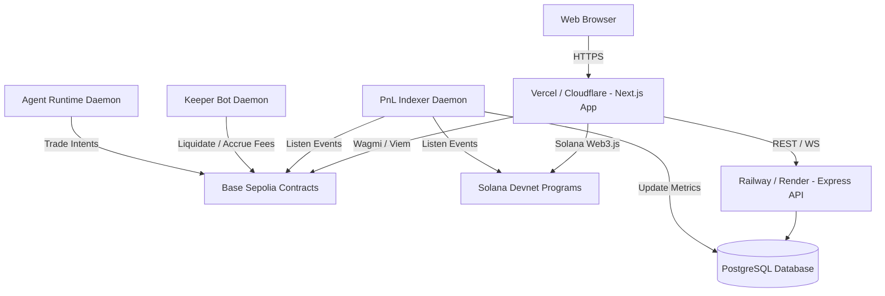

# 🚢 ViperX Public Deployment & Hosting Guide

This guide details how to deploy the complete **ViperX** dual-chain stack live to the public internet.

---

## 🏗️ System Architecture



---

## 1. 🌐 Frontend Deployment (Vercel)

### Steps:
1. Connect your GitHub repository `ritesh59697/ViperX` to [Vercel](https://vercel.com).
2. Set the **Root Directory** to `frontend`.
3. Configure the **Environment Variables**:
   ```bash
   NEXT_PUBLIC_BASE_VIPER_VAULT=0x68c59b55359Dc36D9E842e7314Da1150a964f4C7
   NEXT_PUBLIC_BASE_VIPER_ROUTER=0x1E8500fA19C416064416Ad5Ed8a68A7d569Cc63F
   NEXT_PUBLIC_BASE_PYTH_ADAPTER=0x36B9e0D1b0702FC59114A87f277b836d482EaF6A
   NEXT_PUBLIC_LEADERBOARD_API_URL=https://your-api.railway.app
   NEXT_PUBLIC_SOLANA_NETWORK=devnet
   NEXT_PUBLIC_SOLANA_RPC_URL=https://api.devnet.solana.com
   ```
4. Click **Deploy**.

---

## 2. 🗄️ Backend & Database Deployment (Railway / Render)

### Database:
1. Provision a managed **PostgreSQL 16+** instance on Railway.
2. Run database migrations:
   ```bash
   cd backend/leaderboard-api
   psql $DATABASE_URL < src/schema.sql
   ```

### Leaderboard API Service:
- **Directory**: `backend/leaderboard-api`
- **Build Command**: `npm install && npm run build`
- **Start Command**: `npm start`
- **Port**: `4000` (or `$PORT`)

### Keeper & Indexer Services (Background Workers):
- **Keeper Daemon**:
  - Directory: `backend/keeper-bot`
  - Start Command: `npm start`
  - Env:
    ```bash
    RPC_URL=https://sepolia.base.org
    VAULT_ADDRESS=0x68c59b55359Dc36D9E842e7314Da1150a964f4C7
    ROUTER_ADDRESS=0x1E8500fA19C416064416Ad5Ed8a68A7d569Cc63F
    KEEPER_PRIVATE_KEY=your_private_key
    ```
- **PnL Indexer**:
  - Directory: `backend/pnl-indexer`
  - Start Command: `npm start`
  - Env: `DATABASE_URL=...` and `RPC_URL=https://sepolia.base.org`

---

## 3. ⛓️ Deployed Contract Verification Links

### 1. Base Sepolia (Chain ID 84532)
*Primary deployment*

- **`ViperVault`**: [View on BaseScan](https://sepolia.basescan.org/address/0x68c59b55359Dc36D9E842e7314Da1150a964f4C7) (`0x68c59b55359Dc36D9E842e7314Da1150a964f4C7`)
- **`PositionRouter`**: [View on BaseScan](https://sepolia.basescan.org/address/0x1E8500fA19C416064416Ad5Ed8a68A7d569Cc63F) (`0x1E8500fA19C416064416Ad5Ed8a68A7d569Cc63F`)
- **`PythPriceAdapter`**: [View on BaseScan](https://sepolia.basescan.org/address/0x36B9e0D1b0702FC59114A87f277b836d482EaF6A) (`0x36B9e0D1b0702FC59114A87f277b836d482EaF6A`)

### 2. Solana Devnet
*Secondary venue*

- **`viperx_agent_registry`**: [View on Solana Explorer](https://explorer.solana.com/address/321hJbttyyeZ8pzisiKB93a5XdopV2N6n2gtvwrdQVRm?cluster=devnet) (`321hJbttyyeZ8pzisiKB93a5XdopV2N6n2gtvwrdQVRm`)
- **`viperx_perpetuals`**: [View on Solana Explorer](https://explorer.solana.com/address/6Deo4a3kxfhykzK82ghBrwMY4nHE613Nz9ejb46WFcED?cluster=devnet) (`6Deo4a3kxfhykzK82ghBrwMY4nHE613Nz9ejb46WFcED`)
